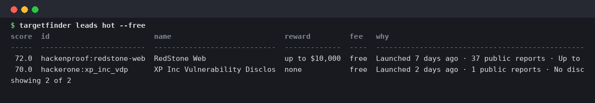
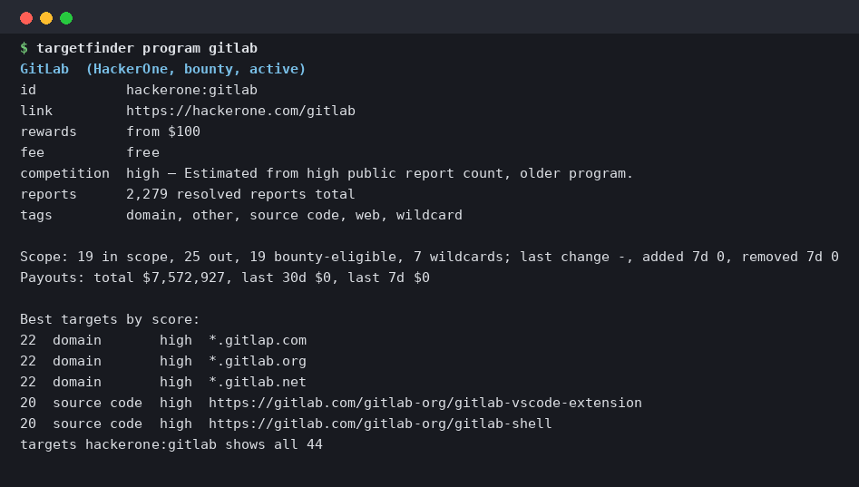
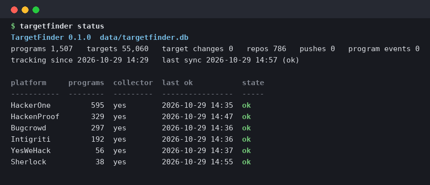

# TargetFinder

Find bug-bounty targets worth your time, from public data, on your own machine. TargetFinder collects
the scope of every public program on HackerOne, Bugcrowd, Intigriti, YesWeHack, HackenProof and
Sherlock, tracks what changed since the last run (new programs, new targets, removed targets, fee and
reward changes, pushes to in-scope source repositories) and serves it through a CLI, a local HTTP API
and an MCP server for AI assistants.

## What it looks like

`targetfinder leads hot --free`: programs worth a look right now, free to submit to.



`targetfinder program gitlab`: one program as a card, with its best-scored targets.



`targetfinder status`: collector health, so you know the data is fresh.



## Who this is for

People hunting their first bounty. The hard part early on is not finding bugs, it is picking a target
that is fresh, in scope, pays, and is not already crowded. TargetFinder puts that information in one
place and tells you when it changes. If you would rather not run anything, the hourly data published by
the GitHub Action (see below) is the same thing as JSON files.

**Always confirm scope on the program page before testing.** Platforms change scope, rules and rewards
without notice; the program page is the only source that counts when you submit.

## Quickstart

```bash
git clone https://github.com/NaroChatyan/targetfinder.git && cd targetfinder
bin/targetfinder init                     # first run: collects every platform (10–20 min), writes public/ snapshots
bin/targetfinder sweep                    # the report: new programs, fee changes, added/removed targets, pushes, rankings
```

Keep it fresh, pick one:

```bash
bin/targetfinder sweep --sync             # on demand: collect, then report
bin/targetfinder schedule install --every 1   # hourly in the background (systemd user timer on Linux, launchd on macOS; prints the schtasks command on Windows)
bin/targetfinder loop --every 2           # foreground loop: sync + sweep every 2 hours, Ctrl-C to stop
```

Or as a container, with the data kept in a named volume:

```bash
docker build -t targetfinder .
docker run -v targetfinder-data:/data targetfinder init
docker run -v targetfinder-data:/data targetfinder sweep
docker run -i -v targetfinder-data:/data targetfinder          # the MCP server over stdio
```

Reports land in `sweeps/SWEEP_<date>.md` with a JSON twin. The first run records a baseline, so the
first sweep shows no "added" targets: changes are only reported for things TargetFinder had already seen.

## What you get

| command | what it does |
|---|---|
| `targetfinder sweep [--since ISO] [--live-only] [--all-pushes] [--max-per-program N] [--bulk-threshold N]` | the standing report; a paid submission fee is the only thing that gets deprioritised, nothing is hidden |
| `targetfinder programs --free --search gitlab` / `program <id>` / `targets <id>` | browse programs and their scope with scores |
| `targetfinder changes --type added --since 2026-10-01T00:00:00Z --free` | target changes, page or cursor mode |
| `targetfinder commits --since ...` | pushes to in-scope repositories with compare links, classified code / docs / deps / ci / tests |
| `targetfinder leads top|hot|solid|possible [--free]` | programs ranked by freshness, competition and reward |
| `targetfinder rankings scope|rewards|updates|status|payouts|response|all` | activity views over 7/30/90 days |
| `targetfinder watch add "Program name"` then `watch report` | your watchlist; the sweep and the alerts give it its own section |
| `targetfinder clones --dir ~/targets` | which of your local git clones are behind the tracked HEAD, with the pushes you missed |
| `targetfinder diff <push-id>` | saves the compare diff of a push to `sweeps/diffs_<date>/` |
| `targetfinder search api.example.com` | which program lists an asset |
| `targetfinder serve` | HTTP API on `http://127.0.0.1:8787/api/` (docs/API.md) |
| `targetfinder mcp` | MCP server over stdio (18 tools, docs/API.md) |
| `targetfinder status` | counts, collectors, last successful run per platform, stale flags |
| `targetfinder resolve nado` / `payouts <id>` | find a program id from a name; payout signals and platform-published facts |

Every lookup prints a readable table; add `--json` for the same data as JSON. `targetfinder` alone prints
the grouped command list, `targetfinder <command> -h` the options. Exit codes: 0 ok, 1 not found, 2 usage
error, 3 every collector failed. Colors appear only on a terminal and honour `NO_COLOR`.

### Alerts (Discord / Telegram)

```bash
bin/targetfinder notify setup --discord <webhook-url> --telegram-token <bot-token> --telegram-chat <chat-id>
bin/targetfinder notify test
```

After every sync you get: brand-new programs with their scope, watchlist changes (targets, fee, rewards,
status, code pushes) and fresh in-scope targets everywhere (free-submission only by default; tune with
`notify setup --min-score 50 --platforms HackerOne,YesWeHack --free-only off`). Nothing is sent twice; the
first sync after setup only initialises the cursors. Credentials live in `data/notify.json` (mode 600) or
in `DISCORD_WEBHOOK_URL`, `TELEGRAM_BOT_TOKEN`, `TELEGRAM_CHAT_ID`.

### MCP (Claude Code, Cursor, any MCP client)

```json
{"mcpServers": {"targetfinder": {"command": "/path/to/targetfinder/bin/targetfinder", "args": ["mcp"]}}}
```

Start with the `guide` tool. `recent_target_changes` and `recent_repo_pushes` take an `after_id` cursor
for polling; `find_programs` and `leads` accept `free_submission_only`.

## Use the published data without running anything

The repository's GitHub Action runs `sync` every hour and commits JSON snapshots to the `data` branch:
`programs.json`, `targets.json` (active and inactive rows with `added_at` / `removed_at`), `repos.json`
(tracked HEADs), and 90-day windows of `target_changes_90d.json`, `program_events_90d.json`,
`repo_changes_90d.json`, `payouts_90d.json`, plus `meta.json`. Fetch them raw, or clone and run
`bin/targetfinder import-snapshot --in public` to get a local database with history, then `sync` to
continue from there. The `data` branch always holds exactly one commit (each run rewrites it, so the
repository does not grow by 55 MB an hour); the 90-day history is inside the files. GitHub pauses scheduled
workflows after 60 days without commits, which the hourly data commits prevent.

## Data sources

| platform | what is read | notes |
|---|---|---|
| HackerOne | public directory GraphQL (programs, structured scopes, public stats) | reports/90d, paid/90d, first-response hours feed the briefs |
| Bugcrowd | `engagements.json`; scope from bounty-targets-data or the engagement changelog | VDPs detected from the reward summary |
| Intigriti | public programs API; scope from bounty-targets-data | only public-scope programs have targets |
| YesWeHack | public API: programs and program detail | submission cost in credits is the fee |
| HackenProof | listing and program pages | submission fee and reward table from the program page |
| Sherlock | bug-bounties listing and detail pages | the per-report USDC deposit is recorded as the fee |
| Immunefi | **off by default** (its terms prohibit automated access, docs/PLATFORMS.md) | `TARGETFINDER_ENABLE_IMMUNEFI=1` opts in for personal use |

Request rates are conservative (one request in flight per host, at least one second apart, 1.5 s on
HackerOne) with an identifying User-Agent. Every collector has fixture tests; a platform that changes
its pages makes its collector fail loudly, keeps the previous data intact, and is flagged **stale** in
`status` and at the top of the sweep.

## Scores are heuristics

competitionRisk and opportunity scores are comparative estimates derived from public counts, not measured probabilities.
Target scores (0–100, labels top/strong/promising/normal), competition levels (low/medium/high/unknown)
and lead tiers (top/hot/solid/possible) are TargetFinder's own point models over freshness, target type,
maximum bounty and public report counts; docs/SCORING.md lists every weight. Report counts mean
different things on different platforms, so use scores to order a list, never to skip reading the
program page.

## Layout

```
targetfinder/        package: collectors/, sync, repowatch, snapshot, queries, model, activity, api, mcp_server, sweep, tools, notify, schedule, cli
bin/targetfinder     launcher
tests/               unittest suite (python3 -m unittest -v); tests/fixtures/ holds recorded, trimmed platform payloads
tools/record_fixtures.py   maintainer tool: re-record the fixtures (network)
docs/                API.md, DESIGN.md, SCORING.md, PLATFORMS.md
public/              JSON snapshots (written by init / export-snapshot, git-ignored on main; the data branch in CI)
data/                your database and logs (git-ignored)
```

Environment: `TARGETFINDER_DATA_DIR`, `TARGETFINDER_DB`, `TARGETFINDER_SWEEP_DIR`, `TARGETFINDER_API_HOST`,
`TARGETFINDER_API_PORT`, `TARGETFINDER_ENABLE_IMMUNEFI`, `GITHUB_TOKEN` (optional: raises the GitHub compare
budget used to classify pushes from 50/h to 5000/h).

## Contributing

Run `python3 -m unittest -v` (no network). To add a platform, write `parse_listing` / `parse_scope` as pure
functions, record a trimmed fixture with `tools/record_fixtures.py`, add the terms review line to
docs/PLATFORMS.md, and register `collect()`. MIT licensed.

## Support

TargetFinder is free and has no paid tier. If it helped you land a bounty and you want to give something
back, small amounts on cheap networks are welcome:

| network | address |
|---|---|
| ETH or USDC on Base, Arbitrum or Ethereum | `0x5e806C4453885d65df0c860CD295ff51af1766B6` |
| USDT (TRC-20) on TRON | `TE5HHm8tVSPYUfSz33dGtLS4HVoxfDgMVV` |

Send on the network named next to the address; funds sent on another network cannot be recovered.
HAPPY HACKING!!!
